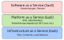

<!--
author:   Günter Dannoritzer
email:    g.dannoritzer@wvs-ffm.de
version:  1.2.1
date:     23.11.2026
language: de
narrator: Deutsch Female

comment:  Cloud Computing

icon:    https://raw.githubusercontent.com/dsp77/wvs-liascript/0938e2e0ce751e270e3e36b8ecfeb09044a41aa0/wvs-logo.png
logo:     02_img/logo-cloud.jpg

tags:     LiaScript, Cloud, Deployment Model, Service Model, NIST, * as a Service, *aaS, Public Cloud, Private Cloud, Hybrid Cloud, Community Cloud, Shared Responsibility, DSGVO

link:     https://cdn.jsdelivr.net/chartist.js/latest/chartist.min.css

script:   https://cdn.jsdelivr.net/chartist.js/latest/chartist.min.js

attribute: Lizenz: [CC BY-SA](https://creativecommons.org/licenses/by-sa/4.0/)
-->
# Cloud-Systeme

Das [National Institute of Standards and Technology (NIST)](https://www.nist.gov/) war die erste Standardisierungsorganisation, die eine Definition von Cloud-Systemen erstellt. Mittlerweile hat diese Beschreibung auch in einem ISO-Standard **ISO/IEC 22123-1** Einzug gefunden. Die NIST-Empfehlung [SP 800-145](https://nvlpubs.nist.gov/nistpubs/Legacy/SP/nistspecialpublication800-145.pdf) beschreibt als essenzielle Charakteristik von Cloud-Computing als:

 * On-demand self-service
 * Broad network access
 * Resource pooling
 * Rapid elasticity
 * Measured service

Im Detail bedeuten diese Charakteristiken:

1. On-demand Self-service (Selbstbedienung auf Abruf)
Beschreibung: Nutzer können Cloud-Ressourcen (z. B. Server, Speicherplatz, Netzwerke) nach Bedarf automatisch und ohne menschliche Interaktion mit dem Anbieter anfordern und nutzen.
Vorteile:
Maximale Flexibilität für Nutzer, die sofort Ressourcen bereitstellen oder anpassen können.
Reduziert die Abhängigkeit von IT-Abteilungen oder Service-Mitarbeitern.
Beispiel: Ein Entwickler startet über ein Webportal eine virtuelle Maschine in der Cloud, ohne auf Genehmigungen oder manuelle Bereitstellungen warten zu müssen.

2. Broad Network Access (Breiter Netzwerkzugriff)
Beschreibung: Cloud-Dienste sind über Standardnetzwerke (z. B. das Internet) zugänglich und können von verschiedenen Geräten wie Laptops, Smartphones oder Tablets genutzt werden.
Vorteile:
Ermöglicht Zugriff auf Cloud-Ressourcen von überall und mit fast jedem Gerät.
Fördert die Nutzung moderner Arbeitsmodelle wie Remote Work.
Beispiel: Ein Mitarbeiter kann auf eine SaaS-Anwendung wie Google Workspace zugreifen, egal ob er sich im Büro, zu Hause oder unterwegs befindet.

3. Resource Pooling (Ressourcen-Pooling)
Beschreibung: Die Cloud-Anbieter konsolidieren Ressourcen (z. B. Server, Speicher, Netzwerke) in einem Pool, aus dem mehrere Kunden (Mandanten) bedarfsorientiert versorgt werden. Diese Multi-Tenant-Architektur nutzt Virtualisierungstechnologie, um Ressourcen effizient zu verteilen.
Vorteile:
Kosteneffizienz durch gemeinsame Ressourcennutzung.
Flexibilität, da Ressourcen dynamisch zugewiesen und wieder freigegeben werden können.
Beispiel: Mehrere Unternehmen teilen sich die Rechenressourcen eines Cloud-Anbieters, ohne Zugriff auf die Daten anderer Unternehmen zu haben.

4. Rapid Elasticity (Schnelle Elastizität)
Beschreibung: Ressourcen können je nach Bedarf schnell skaliert werden – sowohl nach oben (mehr Ressourcen) als auch nach unten (weniger Ressourcen). Diese Skalierbarkeit erscheint dem Nutzer oft unbegrenzt und ist automatisiert.
Vorteile:
Ermöglicht es Unternehmen, auf schwankende Anforderungen zu reagieren, z. B. Spitzenlasten in der Nutzung.
Optimiert Kosten, da nur tatsächlich benötigte Ressourcen verwendet werden.
Beispiel: Ein Online-Shop kann während des Weihnachtsgeschäfts die Anzahl der Server erhöhen und nach dem Geschäftsrückgang wieder reduzieren.

5. Measured Service (Messbarer Dienst)
Beschreibung: Cloud-Systeme überwachen und messen automatisch die Ressourcennutzung (z. B. Speicher, Bandbreite, Rechenleistung). Diese Nutzung wird oft transparent und exakt abgerechnet, was unter dem Begriff **pay-per-use** bekannt ist. 
Vorteile:
Bietet eine genaue Kostenkontrolle, da nur genutzte Ressourcen berechnet werden.
Fördert Effizienz durch Transparenz und Verfügbarkeit von Nutzungsdaten.
Beispiel: Ein Unternehmen bezahlt für Cloud-Speicherplatz nur auf Basis der tatsächlich genutzten Gigabytes pro Monat.


Zusammenfassung

Diese fünf Charakteristiken machen ein Cloud-System aus und stellen sicher, dass es skalierbar, effizient und flexibel ist. Sie bilden die Grundlage für die wirtschaftlichen und technischen Vorteile, die Cloud Computing mit sich bringt.

Nach der Charakterisierung beschreibt die NIST-Empfehlung zwei Modelle, nach denen einmal die Umsetzung der Implementierung beschrieben wird, was mithilfe des sogenannten **Deployment-Models** geschieht. In einer anderen Dimension werden die Dienste beschrieben, was in dem sogenannten **Service-Model** geschieht.

## Deployment Model

Das NIST definiert vier Deployment Models für Cloud Computing. Sie beschreiben, wie und für wen Cloud-Infrastrukturen bereitgestellt werden. Hier ist eine Übersicht:

1. Private Cloud
Beschreibung: Die Cloud-Infrastruktur wird ausschließlich für eine einzelne Organisation betrieben. Sie kann entweder von der Organisation selbst verwaltet werden oder von einem Drittanbieter betrieben werden, und sie kann sich vor Ort (on-premises) oder extern befinden.
Vorteile: Höhere Kontrolle, maßgeschneiderte Sicherheitsmaßnahmen, Einhaltung von Compliance-Anforderungen.
Beispiel: Ein Unternehmen betreibt eine Cloud für interne Anwendungen wie HR-Systeme oder CRM.

2. Public Cloud
Beschreibung: Die Cloud-Infrastruktur wird der breiten Öffentlichkeit oder einer großen Gruppe von Nutzern bereitgestellt. Sie wird von einem Cloud-Service-Provider betrieben und befindet sich im Eigentum des Providers.
Vorteile: Kosteneffizienz, Skalierbarkeit, keine Verwaltung durch die Nutzer notwendig.
Beispiel: Dienste wie Amazon Web Services (AWS), Microsoft Azure oder Google Cloud Platform (GCP).

3. Community Cloud
Beschreibung: Die Cloud-Infrastruktur wird von mehreren Organisationen genutzt, die gemeinsame Interessen oder Anforderungen haben (z. B. Compliance, Sicherheit, Branche). Sie kann von einer der Organisationen oder einem Drittanbieter verwaltet werden.
Vorteile: Gemeinsame Kosten, abgestimmte Sicherheitsmaßnahmen, Zusammenarbeit zwischen den Mitgliedern der Community.
Beispiel: Eine Gruppe von Universitäten teilt eine Cloud für Forschungsprojekte.

4. Hybrid Cloud
Beschreibung: Die Cloud-Infrastruktur ist eine Kombination aus zwei oder mehr Cloud-Deployment-Modellen (z. B. Private und Public Cloud), die über standardisierte oder proprietäre Technologie miteinander verbunden sind, um Daten und Anwendungen zu portieren.
Vorteile: Flexibilität, Workload-Optimierung, Anpassung an spezifische Bedürfnisse.
Beispiel: Ein Unternehmen speichert sensible Daten in einer Private Cloud und nutzt eine Public Cloud für weniger kritische Workloads wie Webhosting.

### Unterschied Public und Private Cloud

Bezüglich dem Unterschied zwischen einer Public und Private Cloud soll hier noch mal die Bereitstellung durch einen Drittanbieter beschrieben werden.

Es ist möglich, dass eine Private Cloud von einem Drittanbieter (z. B. Amazon oder Google) betrieben wird. Das unterscheidet sich jedoch wesentlich von einer Public Cloud, auch wenn der Betrieb durch denselben Anbieter erfolgt.

Merkmale einer Private Cloud durch Drittanbieter

Dedizierte Infrastruktur:

Bei einer Private Cloud stellt der Anbieter dedizierte Ressourcen (z. B. Server, Speicher, Netzwerk) für einen einzelnen Kunden bereit. Diese Infrastruktur wird nicht mit anderen Kunden geteilt.
Beispiel: Amazon bietet mit AWS Outposts oder Azure Private Cloud Lösungen an, die vollständig auf den Kunden zugeschnitten und isoliert sind.

Zugriff und Kontrolle:

Der Kunde hat möglicherweise keinen physischen Zugriff auf die Hardware (wie bei einer on-premises Private Cloud), aber die Infrastruktur bleibt logisch und physisch vollständig isoliert.
Zudem kann der Kunde maßgeschneiderte Sicherheitsrichtlinien, Netzwerkkonfigurationen und Compliance-Vorgaben durchsetzen.

Management durch den Drittanbieter:

Ein Drittanbieter kann die Wartung und Verwaltung der Private Cloud übernehmen, z. B. Updates, Sicherheitspatches und Infrastrukturüberwachung. Dies entlastet den Kunden.
Warum ist eine von Amazon oder Google betriebene Private Cloud keine Public Cloud?
Der Schlüssel zur Unterscheidung liegt in der Isolierung:

Private Cloud: Vollständig isolierte Ressourcen, exklusiv für einen Kunden bereitgestellt.
Public Cloud: Ressourcen werden gemeinsam mit anderen Nutzern verwendet (Shared Infrastructure).
Selbst wenn der Betrieb der Private Cloud extern erfolgt, bleibt sie per Definition dediziert und daher eine Private Cloud.

Viele Cloud-Anbieter bieten Private Cloud-Lösungen an:

Amazon AWS: Lösungen wie "AWS Outposts" oder dedizierte Server.
Microsoft Azure: Azure Stack ermöglicht private Cloud-Umgebungen.
Google Cloud: Anthos ermöglicht die Bereitstellung privater Cloud-Lösungen.
Der entscheidende Unterschied zur Public Cloud ist die exklusive Nutzung der Ressourcen und die Kontrolle über Sicherheits- und Managementrichtlinien.


### Deployment-Modelle als einheitliche Schemata

Die folgenden vereinfachten Darstellungen verwenden immer dieselben Symbole. Ein Kasten steht für eine organisatorisch abgegrenzte Cloud-Umgebung, Kreise stehen für nutzende Organisationen und die Wolke für die bereitgestellten Cloud-Ressourcen.

#### Private Cloud

```ascii
┌──────────── Organisation A ────────────┐
│                                        │
│   (Nutzer A)  ─────>   Private Cloud   │
│                       exklusiv für A   │
└────────────────────────────────────────┘
```

Die Ressourcen sind exklusiv einer Organisation zugeordnet. Der Betrieb kann im eigenen Rechenzentrum oder bei einem externen Anbieter erfolgen.

#### Public Cloud

```ascii
 (Organisation A) ──┐
 (Organisation B) ──┼──>  Public Cloud
 (Organisation C) ──┘    Ressourcen des Providers
                           logisch getrennte Mandanten
```

Ein Provider stellt standardisierte, gemeinsam genutzte Ressourcen für viele voneinander unabhängige Kunden bereit.

#### Community Cloud

```ascii
┌────── gemeinsame Community-Anforderungen ──────┐
│ (Organisation A) ──┐                           │
│ (Organisation B) ──┼──>  Community Cloud       │
│ (Organisation C) ──┘    nur für die Community  │
└────────────────────────────────────────────────┘
```

Mehrere Organisationen mit gemeinsamen Anforderungen, etwa Behörden, Hochschulen oder Einrichtungen des Gesundheitswesens, teilen sich die Cloud.

#### Hybrid Cloud

```ascii
┌──────── Organisation A ────────┐       Provider
│ ☁ Private Cloud                │        Public Cloud
│ sensible Daten und Kernsysteme │<─────> Lastspitzen und Webdienste
└────────────────────────────────┘  sichere Kopplung
```

Mindestens zwei unterschiedliche Deployment-Modelle bleiben eigenständig, sind aber technisch verbunden. Daten und Anwendungen können – abhängig von Schutzbedarf und Architektur – zwischen ihnen ausgetauscht werden.

> **Merksatz:** Das Deployment-Modell beantwortet vor allem: *Wer darf die Cloud nutzen und wie ist sie organisatorisch bereitgestellt?* Das Service-Modell beantwortet: *Welche Schichten betreibt der Anbieter und welche der Kunde?*

## Service Model

Das Service Model im Cloud Computing beschreibt die verschiedenen Dienstebenen, die Cloud-Anbieter ihren Nutzern bereitstellen. Die NIST-Definition unterscheidet dabei drei Haupt-Service-Modelle:

 * Infrastructure as a Service (IaaS)
 * Platform as a Service (PaaS)
 * Software as a Service (Saas)

Im folgenden werden die drei Modelle beschrieben.

1. Infrastructure as a Service (IaaS)

Beschreibung:
Bei IaaS wird die grundlegende IT-Infrastruktur (z. B. virtuelle Maschinen, Speicher, Netzwerke) bereitgestellt. Nutzer haben die volle Kontrolle über die Infrastruktur und können darauf eigene Software installieren.

Merkmale:
Zugriff auf virtuelle oder physische Hardware.
Skalierbare Ressourcen (z. B. Speicherplatz, Rechenleistung).
Nutzer verwalten Betriebssysteme, Middleware und Anwendungen selbst.

Vorteile:
Hohe Flexibilität und Kontrolle.
Pay-as-you-go-Modell für kosteneffiziente Nutzung.

Beispiele:
Amazon Web Services (AWS EC2, S3).
Microsoft Azure Virtual Machines.
Google Compute Engine.

2. Platform as a Service (PaaS)

Beschreibung:
PaaS stellt eine Plattform bereit, auf der Nutzer Anwendungen entwickeln, testen und betreiben können, ohne sich um die zugrunde liegende Infrastruktur kümmern zu müssen.

Merkmale:
Entwicklungs- und Laufzeitumgebungen inklusive Middleware, Datenbanken und Tools.
Automatische Verwaltung von Infrastruktur und Betriebssystemen durch den Anbieter.
Entwickler können sich auf die Anwendungsentwicklung konzentrieren.

Vorteile:
Beschleunigt die Entwicklung und Bereitstellung von Anwendungen.
Keine Verwaltung von Servern oder Infrastruktur durch den Nutzer.

Beispiele:
Google App Engine.
Microsoft Azure App Service.
Heroku.

3. Software as a Service (SaaS)

Beschreibung:
Bei SaaS stellt der Anbieter vollständig funktionierende Anwendungen bereit, die direkt über das Internet genutzt werden können. Der Nutzer muss weder Infrastruktur noch Plattform verwalten.

Merkmale:
Anwendungen laufen auf den Servern des Anbieters und werden über einen Webbrowser oder eine App genutzt.
Nutzer greifen auf Software zu, ohne Installation oder Verwaltung.
Updates und Wartung erfolgen durch den Anbieter.

Vorteile:
Sofortige Nutzung ohne technischen Aufwand.
Skalierbar, um die Anforderungen verschiedener Nutzergruppen zu erfüllen.

Beispiele:
Google Workspace (Gmail, Docs).
Microsoft 365.
Salesforce.

Vergleich der Service-Modelle

| Merkmal | IaaS | PaaS | SaaS |
|---------|------|------|------|
| Bereitstellung | Infrastruktur (VMs, Speicher) | Entwicklungsplattform | Fertige Anwendungen |
| Nutzerkontrolle | Vollständig über OS und Apps | Nur über Apps und Daten | Minimal (nur Nutzung der App) |
| Flexibilität | Sehr hoch | Mittel | Niedrig |
| Beispiele | AWS EC2, Azure VMs | Google App Engine, Heroku | Gmail, Microsoft Office 365 |


Man kann sich die Modelle als eine Art **Schichtenmodell** vorstellen:



 1. IaaS bildet die Basis (Infrastruktur).
 2. PaaS baut darauf auf (Plattform).
 3. SaaS steht ganz oben (fertige Software).

Anwendungsfälle

 * IaaS: Unternehmen, die volle Kontrolle benötigen, z. B. für eigene IT-Systeme.
 * PaaS: Entwickler, die schnell Anwendungen erstellen möchten, ohne sich um die Infrastruktur zu kümmern.
 * SaaS: Endnutzer, die einfach Anwendungen verwenden möchten (z. B. E-Mail, CRM).

### Abgrenzung zu anderen *aaS-Modellen

Es gibt weitere Dienste, die nach dem Schema *aaS benannt sind, z. B. Database as a Service (DBaaS), Function as a Service (FaaS), Backend as a Service (BaaS), usw. Diese zusätzlichen Dienste bauen auf den drei Haupt-Service-Modellen des NIST (IaaS, PaaS, SaaS) auf und erweitern oder spezifizieren sie. Schauen wir uns die Unterschiede genauer an:

1. Die NIST-Modelle als Grundlage

Die drei NIST-Modelle IaaS, PaaS und SaaS sind:

Grundlegend: Sie definieren die drei Hauptschichten im Cloud-Computing-Stack:
IaaS: Hardware und Infrastruktur.
PaaS: Entwicklungsplattformen.
SaaS: Anwendungen.
Generisch: Sie decken breite Einsatzbereiche ab und sind nicht auf spezielle Funktionen oder Anwendungsfälle beschränkt.
Alle anderen *aaS-Modelle lassen sich meistens in eine dieser drei Kategorien einordnen oder bauen direkt auf ihnen auf.

2. Wie andere aaS-Modelle sich unterscheiden

Zusätzliche *aaS-Dienste:

Spezialisierung: Sie sind oft auf spezifische Aufgaben, Funktionen oder Branchen ausgelegt.
Granularität: Sie können als Unterkategorien eines der Hauptmodelle betrachtet werden, da sie sich auf spezifische Dienste konzentrieren.
Neue Abstraktionsebenen: Manche *aaS-Modelle bieten Abstraktionen, die sich nicht klar einem der drei Hauptmodelle zuordnen lassen.

3. Beispiele für spezialisierte aaS-Modelle

| Dienstmodell | Beschreibung | Bezug zu NIST-Modellen |
|--------------|--------------|------------------------|
| Database as a Service (DBaaS) | Bietet eine vollständig verwaltete Datenbank über die Cloud an. |Unterkategorie von PaaS, da es eine spezifische Plattform für Datenbanken bereitstellt. |
| Function as a Service (FaaS) | Ermöglicht die Ausführung von Code als kleine, unabhängige Funktionen, ohne sich um die Infrastruktur zu kümmern. | Baut auf PaaS oder IaaS auf, häufig Teil von Serverless Computing. |
| Storage as a Service (STaaS) | Stellt Speicherplatz über die Cloud zur Verfügung. | Unterkategorie von IaaS, da es sich auf die Infrastrukturebene konzentriert. |
| Backend as a Service (BaaS) | Bietet vorgefertigte Back-End-Dienste wie Authentifizierung, Datenbanken, und APIs. | Zwischen PaaS und SaaS, da es Entwicklern eine Plattform für Back-End-Dienste bietet. |
| Desktop as a Service (DaaS) | Stellt virtuelle Desktops bereit, die über die Cloud genutzt werden können.| Meist eine Mischung aus SaaS (für den Endnutzer) und IaaS (für die Infrastruktur). |
| Security as a Service (SECaaS) | Bietet Sicherheitsdienste wie Firewalls, Bedrohungserkennung und Verschlüsselung über die Cloud an. | Kann auf allen Schichten basieren, häufig auf IaaS oder SaaS. |

4. Hauptunterschiede zwischen NIST-Modellen und neuen aaS-Modellen

| Merkmal | NIST-Modelle (IaaS, PaaS, SaaS) | *Zusätzliche aaS-Modelle |
|---------|---------------------------------|---------------------------|
| Abstraktionsebene | Fokus auf breite Schichten des Cloud-Stacks | Spezifische Dienste oder Funktionen innerhalb der Schichten. |
| Flexibilität | Generisch und anpassbar für verschiedene Anwendungen | Stark spezialisiert, weniger flexibel. |
| Zielgruppe | Breites Spektrum von Nutzern (Infrastruktur- bis Endnutzer) | Entwicklern oder Endnutzern mit spezifischen Anforderungen. |
| Innovationsgrad | Standardisiert und etabliert | Oft auf neue Technologien oder Trends ausgerichtet, z. B. Serverless, KI. |

5. Einordnung der spezialisierten Modelle in die NIST-Modelle

Fast alle zusätzlichen Dienste (*aaS) können entweder als Unterkategorien oder Ergänzungen zu den NIST-Modellen betrachtet werden:

Unterkategorie von IaaS:

 * Beispiele: Storage as a Service (STaaS), Network as a Service (NaaS).
 * Fokus auf einzelne Infrastrukturkomponenten.

Unterkategorie von PaaS:

 * Beispiele: Database as a Service (DBaaS), Function as a Service (FaaS).
 * Plattformen für spezifische Entwicklungs- oder Ausführungsaufgaben.

Erweiterung von SaaS:

 * Beispiele: Desktop as a Service (DaaS), Security as a Service (SECaaS).
 * Anwendungen für spezialisierte Endnutzungszwecke.

Zusammenfassung

Die drei NIST-Modelle sind die Basis des Cloud Computing und definieren breite Kategorien. Die neueren *aaS-Modelle sind:

 1. **Erweiterungen oder Spezialisierungen** dieser Modelle, angepasst an spezifische Bedürfnisse.
 2. Oft ein Ergebnis technologischer Weiterentwicklungen wie Serverless Computing oder KI.

## Shared-Responsibility-Modell

Cloud-Nutzung bedeutet nicht, dass die gesamte Verantwortung an den Anbieter abgegeben wird. Beim **Shared-Responsibility-Modell** teilen sich Cloud-Anbieter und Cloud-Kunde die Aufgaben. Grundsätzlich schützt der Anbieter die **Cloud-Infrastruktur**; der Kunde schützt seine **Daten, Identitäten, Zugriffsrechte und die von ihm konfigurierten Dienste**. Die genaue Grenze hängt vom Vertrag und vom gewählten Service-Modell ab.

### Verantwortlichkeitsmatrix

**Legende:** **K** = Kunde verantwortlich, **A** = Anbieter verantwortlich. Bei **K/A** bestehen geteilte oder vertraglich abzugrenzende Aufgaben.

| Schicht / Aufgabe | On-Premises | IaaS | PaaS | SaaS |
|---|:---:|:---:|:---:|:---:|
| Daten und Datenklassifizierung | K | K | K | K |
| Benutzer, Rollen und Zugriffsrechte | K | K | K | K/A |
| Anwendung und Anwendungskonfiguration | K | K | K | A/K |
| Laufzeitumgebung und Middleware | K | K | A | A |
| Betriebssystem und Patches | K | K | A | A |
| Virtualisierung | K | A | A | A |
| Server, Speicher und physisches Netzwerk | K | A | A | A |
| Rechenzentrum und physische Sicherheit | K | A | A | A |

> **Wichtig:** Auch bei SaaS bleibt der Kunde insbesondere für rechtmäßige Verarbeitung, Datenklassifizierung, geeignete Benutzerberechtigungen und die sichere Nutzung verantwortlich. Ein Vertrag kann Zuständigkeiten konkretisieren, hebt gesetzliche Pflichten aber nicht automatisch auf.

Je weiter man sich von On-Premises zu SaaS bewegt, desto mehr technische Betriebsverantwortung übernimmt der Anbieter. Gleichzeitig sinken meist die technische Kontrolle und die Freiheit, einzelne Schichten selbst zu gestalten.

### Selbstkontrolle

Wer patcht bei einem typischen IaaS-Angebot das Betriebssystem der virtuellen Maschine?

[(X)] Der Cloud-Kunde
[( )] Immer der Cloud-Anbieter
[( )] Niemand, weil Cloud-Systeme keine Patches benötigen
[[?]] IaaS stellt vor allem Infrastruktur bereit. Das Gastbetriebssystem gehört weiterhin zum Verantwortungsbereich des Kunden.
****************************************

Bei IaaS verantwortet der Anbieter die physische Infrastruktur und die Virtualisierung. Der Kunde administriert und patcht in der Regel das Gastbetriebssystem sowie seine Anwendungen.

****************************************

## Entscheidungshilfe für die Cloud-Auswahl

Eine fachlich begründete Entscheidung betrachtet nicht nur den Preis. Zuerst werden Schutzbedarf, rechtliche Anforderungen und betriebliche Ziele ermittelt; anschließend werden geeignete Deployment- und Service-Modelle verglichen.

| Kriterium | Leitfragen | Typische Auswirkung auf die Auswahl |
|---|---|---|
| DSGVO und Datenschutz | Werden personenbezogene Daten verarbeitet? Wer ist Verantwortlicher, wer Auftragsverarbeiter? Ist ein Vertrag zur Auftragsverarbeitung erforderlich? Sind technische und organisatorische Maßnahmen nachweisbar? | Anbieter, Vertrag, Berechtigungskonzept, Verschlüsselung, Löschkonzept und Nachweise müssen zur Verarbeitung passen. Eine Private Cloud ist nicht automatisch DSGVO-konform und eine Public Cloud nicht automatisch unzulässig. |
| Datenstandort und Drittlandtransfer | In welchem Staat werden Daten gespeichert, verarbeitet, gesichert und administrativ zugänglich? Findet eine Übermittlung in ein Drittland statt? Gibt es einen Angemessenheitsbeschluss oder geeignete Garantien, etwa Standardvertragsklauseln? | Regionen und Supportzugriffe verbindlich klären; Transfergrundlage und zusätzliche Schutzmaßnahmen prüfen und dokumentieren. |
| Kosten | Welche einmaligen und laufenden Kosten entstehen? Wie hoch sind Kosten für Betrieb, Personal, Datenübertragung, Support, Lizenzen und Lastspitzen? | Nicht nur Anschaffungspreise, sondern **Total Cost of Ownership** und variable Nutzungskosten vergleichen. Egress-Kosten beachten. |
| Skalierung | Wie stark und wie schnell schwankt die Last? Muss automatisch hoch- und herunterskaliert werden? | Public-Cloud- und verwaltete Dienste sind oft schnell elastisch; eigene Kapazitäten bieten planbare Grenzen, müssen aber vorgehalten werden. |
| Vendor Lock-in | Werden proprietäre APIs, Datenformate, Identitätsdienste oder Plattformfunktionen verwendet? Wie funktionieren Export und Anbieterwechsel? | Offene Standards, Container, dokumentierte Schnittstellen, Exit-Plan und regelmäßige Exporttests reduzieren Abhängigkeiten. |
| Kontrolle | Welche Konfigurations-, Prüf- und Eingriffsmöglichkeiten werden benötigt? Muss Hardware exklusiv genutzt werden? | On-Premises und Private Cloud bieten meist mehr unmittelbare Kontrolle; PaaS und SaaS reduzieren Betriebsaufwand, aber auch Eingriffsmöglichkeiten. |

### Vorgehensmodell

1. Daten und Anwendungen klassifizieren und Schutzbedarf bestimmen.
2. Muss-, Soll- und Kann-Anforderungen festlegen.
3. Rechtliche und vertragliche Ausschlusskriterien prüfen.
4. Deployment- und Service-Modelle anhand derselben Kriterien vergleichen.
5. Risiken, Kosten und Nutzen über den gesamten Lebenszyklus bewerten.
6. Exit-, Backup-, Notfall- und Wiederanlaufkonzept vor der Einführung festlegen.
7. Entscheidung dokumentieren und regelmäßig überprüfen.

> Diese Übersicht dient der fachlichen Orientierung und ersetzt keine Rechtsberatung. Datenschutzrechtliche Entscheidungen sollten mit den zuständigen Datenschutz- und Rechtsstellen abgestimmt werden.

## Servicequalität, Zuverlässigkeit und Wiederherstellung

Bei der Auswahl eines Cloud-Dienstes genügt es nicht, nur Deployment- und Service-Modell zu betrachten. Unternehmen müssen auch festlegen, **welche Dienstqualität benötigt wird**, **wie sie gemessen wird** und **wie schnell ein Dienst oder Datenbestand nach einer Störung wiederhergestellt werden muss**.

### SLA, SLI und SLO

Die drei Begriffe hängen zusammen, erfüllen aber unterschiedliche Aufgaben:

| Begriff | Bedeutung | Leitfrage | Beispiel |
|---|---|---|---|
| **SLI – Service Level Indicator** | Tatsächlich gemessener Indikator für einen Dienst | Was wurde gemessen? | Im Monat waren 99,94 % der gültigen Anfragen erfolgreich. |
| **SLO – Service Level Objective** | Intern oder gemeinsam festgelegter Zielwert für einen SLI | Welcher Wert soll erreicht werden? | Mindestens 99,9 % erfolgreiche Anfragen pro Kalendermonat. |
| **SLA – Service Level Agreement** | Vertragliche Vereinbarung über die zu erbringende Dienstqualität | Was wird verbindlich zugesagt und was geschieht bei Nichterfüllung? | Monatliche Verfügbarkeit von 99,9 %; bei Unterschreitung entstehen vertraglich definierte Ansprüche. |

Ein **SLI** liefert also den Messwert, ein **SLO** beschreibt das Ziel und ein **SLA** macht ausgewählte Leistungsziele zum Bestandteil einer vertraglichen Vereinbarung. Nicht jedes interne SLO muss Bestandteil eines SLA sein. Ein Anbieter kann intern strengere SLOs verwenden, um die vertragliche Zusage mit Sicherheitsabstand einzuhalten.

Ein aussagekräftiges SLA sollte unter anderem festlegen:

* den betrachteten Dienst und dessen Leistungsumfang,
* eindeutige Messgrößen und Zielwerte,
* Messpunkt, Messverfahren und Bezugszeitraum,
* Betriebs- und Supportzeiten sowie Prioritätsklassen,
* Reaktions-, Wiederherstellungs- und Eskalationszeiten,
* Wartungsfenster und weitere vereinbarte Ausschlüsse,
* Berichte, Nachweise und Ansprechpartner,
* sowie Folgen einer Nichterfüllung, beispielsweise Servicegutschriften oder Sonderkündigungsrechte.

> **Achtung:** Eine Angabe wie „99,9 % verfügbar“ ist ohne Bezugszeitraum, Messpunkt, Definition eines Ausfalls und Ausschlussregeln unvollständig. Außerdem ist eine Servicegutschrift kein technischer Ersatz für ein Notfallkonzept.

### Verfügbarkeit

Die Verfügbarkeit gibt an, welcher Anteil eines betrachteten Zeitraums ein System wie vereinbart nutzbar ist:

$$
Verfügbarkeit = \frac{vereinbarte\ Betriebszeit - anrechenbare\ Ausfallzeit}{vereinbarte\ Betriebszeit}
$$

Bei einer Betriebszeit von 24 Stunden an 365 Tagen ergeben sich näherungsweise folgende maximalen Ausfallzeiten:

| zugesicherte Verfügbarkeit | maximale Ausfallzeit pro Jahr |
|---:|---:|
| 99 % | 87 Stunden 36 Minuten |
| 99,9 % | 8 Stunden 45 Minuten 36 Sekunden |
| 99,95 % | 4 Stunden 22 Minuten 48 Sekunden |
| 99,99 % | 52 Minuten 34 Sekunden |

Die tatsächlich anrechenbare Ausfallzeit hängt von der SLA-Definition ab. Geplante Wartung oder Störungen außerhalb eines festgelegten Messpunkts können beispielsweise ausgeschlossen sein.

### MTBF – Mean Time Between Failures

Die **MTBF** beschreibt bei einem reparierbaren System die durchschnittliche Betriebszeit **zwischen zwei Ausfällen**. Ein hoher Wert deutet darauf hin, dass Ausfälle vergleichsweise selten auftreten.

$$
MTBF = \frac{gesamte\ Betriebszeit}{Anzahl\ der\ Ausfälle}
$$

Beispiel: Ein System war zwischen mehreren Reparaturen insgesamt 4.800 Stunden in Betrieb und ist in diesem Zeitraum viermal ausgefallen.

$$
MTBF = \frac{4.800\ Stunden}{4} = 1.200\ Stunden
$$

Die MTBF ist ein statistischer Durchschnittswert. Sie bedeutet nicht, dass der nächste Ausfall exakt nach 1.200 Stunden eintritt, und sie ist keine garantierte Mindestlebensdauer.

### MTTR – Mean Time to Repair oder Mean Time to Restore

Die Abkürzung **MTTR** wird in der Praxis unterschiedlich verwendet. Häufig bedeutet sie:

* **Mean Time to Repair:** durchschnittliche Zeit für die technische Reparatur oder
* **Mean Time to Restore/Recover:** durchschnittliche Zeit, bis der Dienst wieder nutzbar ist.

Deshalb muss in Dokumentationen und SLAs ausdrücklich festgelegt werden, welche Bedeutung, welcher Startzeitpunkt und welcher Endzustand gemeint sind. Eine kleinere MTTR steht für eine schnellere Wiederherstellung.

$$
MTTR = \frac{gesamte\ Reparatur-\ oder\ Wiederherstellungszeit}{Anzahl\ der\ Ausfälle}
$$

Unter vereinfachten Bedingungen kann die technische Verfügbarkeit eines reparierbaren Systems aus MTBF und MTTR abgeschätzt werden:

$$
Verfügbarkeit = \frac{MTBF}{MTBF + MTTR}
$$

Beispiel mit MTBF = 1.200 Stunden und MTTR = 3 Stunden:

$$
Verfügbarkeit = \frac{1.200}{1.200 + 3} \approx 99{,}751\,\%
$$

Diese Näherung ersetzt keine SLA-Berechnung. Sie betrachtet ein vereinfachtes System und berücksichtigt beispielsweise keine Wartungsfenster, Abhängigkeiten oder unterschiedlichen Fehlerklassen.

### RTO – Recovery Time Objective

Das **RTO** ist die angestrebte maximale Zeitspanne zwischen dem Ausfall und der Wiederherstellung eines Geschäftsprozesses oder IT-Dienstes auf ein zuvor definiertes Mindestniveau.

Beispiel: Ein RTO von zwei Stunden bedeutet, dass der betroffene Dienst nach einer Störung innerhalb von höchstens zwei Stunden wieder in dem vereinbarten Umfang nutzbar sein soll.

Ein kurzes RTO erfordert häufig zusätzliche technische und organisatorische Maßnahmen, etwa Redundanz, automatisiertes Failover, vorbereitete Ersatzumgebungen, klare Alarmierungswege und regelmäßig getestete Wiederanlaufpläne.

### RPO – Recovery Point Objective

Das **RPO** beschreibt den maximal tolerierbaren Datenverlust, ausgedrückt als Zeitspanne. Es beantwortet die Frage, bis zu welchem Zeitpunkt Daten nach einer Wiederherstellung mindestens vorliegen müssen.

Beispiel: Bei einem RPO von 15 Minuten dürfen nach einer Störung höchstens die Änderungen der letzten 15 Minuten fehlen. Dafür müssen Sicherung oder Replikation in einem ausreichend kurzen Intervall erfolgen.

Ein RPO von null würde bedeuten, dass kein Datenverlust akzeptiert wird. Dies erfordert in der Regel eine kontinuierliche oder synchrone Datenübertragung und ist technisch wie wirtschaftlich anspruchsvoll.

### Abgrenzung von MTTR, RTO und RPO

| Kennwert | Art | Kernaussage |
|---|---|---|
| **MTTR** | rückblickend gemessener Durchschnittswert | Wie lange dauerte die Reparatur oder Wiederherstellung durchschnittlich tatsächlich? |
| **RTO** | vorausblickender Zielwert | Wie lange darf die Wiederherstellung höchstens dauern? |
| **RPO** | vorausblickender Zielwert | Wie viele Minuten oder Stunden an Datenänderungen dürfen höchstens verloren gehen? |

RTO und RPO werden aus dem Schutzbedarf und einer Business-Impact-Analyse abgeleitet. Sie beeinflussen Architektur, Backup-Konzept, Replikation, Personalbedarf und Kosten.

### Selbstkontrolle: Begriffe unterscheiden

Welcher Begriff bezeichnet einen **tatsächlich gemessenen** Wert?

[(X)] SLI
[( )] SLO
[( )] SLA
[( )] RTO
****************************************

Der SLI ist der gemessene Indikator. Das SLO ist der Zielwert; das SLA ist die vertragliche Vereinbarung.

****************************************

### Selbstkontrolle: Wiederherstellungsziele

Nach einem Ausfall ist das System nach 90 Minuten wieder nutzbar. Es fehlen die Datenänderungen der letzten zehn Minuten. Welcher Wert beschreibt den maximal akzeptierten Datenverlust?

[( )] MTBF
[( )] MTTR
[( )] RTO
[(X)] RPO
****************************************

Das RPO wird als Zeitspanne angegeben und begrenzt den akzeptierten Datenverlust. Die Dauer bis zur Wiederherstellung gehört zum RTO beziehungsweise als Messwert zur MTTR.

****************************************

### Selbstkontrolle: Verfügbarkeit berechnen

Ein reparierbares System hat eine MTBF von 500 Stunden und eine MTTR von 2 Stunden. Welche theoretische Verfügbarkeit ergibt sich näherungsweise?

[( )] 96,000 %
[( )] 98,000 %
[(X)] 99,602 %
[( )] 99,999 %
****************************************

$$
\frac{500}{500 + 2} \cdot 100 \approx 99{,}602\,\%
$$

****************************************

## Fallaufgabe: Cloud-Lösung für die NovaWerk Gerätebau GmbH

Die **NovaWerk Gerätebau GmbH** ist ein vollständig fiktives Unternehmen mit rund 120 Beschäftigten. Sie entwickelt Mess- und Prüfgeräte für gewerbliche Kunden. Im eigenen Serverraum laufen derzeit eine Warenwirtschaft, eine Anwendung zur Produktionsplanung und eine zentrale Ablage für Konstruktionsunterlagen. Diese Systeme enthalten personenbezogene Kunden- und Beschäftigtendaten sowie vertrauliche technische Zeichnungen. Ein längerer Ausfall der Produktionsplanung würde Montage und Auslieferung verzögern.

Zusätzlich soll ein neues Kundenportal eingeführt werden, über das Serviceeinsätze gebucht und Messprotokolle abgerufen werden können. Nach der Auslieferung neuer Produktserien rechnet NovaWerk zeitweise mit ungefähr sechsmal so vielen Portalzugriffen wie im Normalbetrieb. Die vierköpfige IT-Abteilung möchte den Aufwand für Plattformbetrieb und Patchmanagement reduzieren. Ein möglicher Cloud-Anbieter betreibt wählbare Regionen innerhalb der EU, greift für einzelne Supportleistungen aber auch auf Personal außerhalb der EU/des EWR zurück. Für das Kundenportal werden sowohl ein IaaS-Angebot als auch ein verwalteter PaaS-Dienst angeboten. Die Geschäftsführung fordert nachvollziehbare laufende Kosten, bedarfsgerechte Skalierung und eine realistische Wechselmöglichkeit zu einem anderen Anbieter.

### Arbeitsauftrag – Grundniveau

1. Ordnen Sie für die internen Produktionssysteme und das neue Kundenportal jeweils ein sinnvolles Deployment-Modell und Service-Modell zu.
2. Begründen Sie jede Wahl mit mindestens drei Kriterien aus der Entscheidungshilfe.
3. Nennen Sie je zwei Verantwortlichkeiten der NovaWerk Gerätebau GmbH und des Cloud-Anbieters.

Welches Konzept ist unter den genannten Anforderungen am besten begründbar?

[( )] Alle Systeme unverändert On-Premises betreiben; Datenschutz und Skalierung müssen dann nicht mehr geprüft werden.
[(X)] Interne Produktionssysteme zunächst kontrolliert in einer privaten oder hybriden Umgebung betreiben und das Kundenportal elastisch in einer Public Cloud bereitstellen; für beide Teile Datenschutz, Verträge, Schnittstellen und Exit-Strategie prüfen.
[( )] Sämtliche Systeme ohne weitere Prüfung als SaaS buchen; damit trägt ausschließlich der Anbieter die Verantwortung.
[( )] Den billigsten Anbieter auswählen; Datenstandort und Exportmöglichkeiten sind nach Vertragsabschluss nachrangig.
[[?]] Trennen Sie die Anforderungen der Workloads: Produktionsplanung und Konstruktionsdaten haben hohen Schutz- und Verfügbarkeitsbedarf; beim Kundenportal kommt eine stark schwankende Zugriffslast hinzu.
****************************************

Eine gut begründbare Lösung ist eine **Hybrid-Cloud-Strategie**: Die internen Produktionssysteme und vertraulichen Konstruktionsdaten verbleiben zunächst in einer kontrollierten privaten Umgebung oder werden erst nach einer Schutzbedarfs- und Migrationsanalyse verlagert. Das Kundenportal kann die Elastizität einer Public Cloud nutzen. PaaS kann die kleine IT-Abteilung stärker entlasten als IaaS, erhöht aber möglicherweise den Vendor Lock-in. Deshalb sind portable Datenformate, dokumentierte Schnittstellen, Exporttests und ein Exit-Plan wichtig. Für personenbezogene Daten müssen unter anderem Rollen, Auftragsverarbeitung, technische und organisatorische Maßnahmen sowie mögliche Drittlandzugriffe geprüft werden. Auch eine andere Lösung kann fachlich richtig sein, wenn sie die Anforderungen nachvollziehbar gewichtet und Risiken mit geeigneten Maßnahmen behandelt.

****************************************

### Arbeitsauftrag – Fachliche Vertiefung

Erstellen Sie eine Nutzwertanalyse mit mindestens den Kriterien Datenschutz/Compliance, Verfügbarkeit, Skalierung, Gesamtkosten, Kontrollmöglichkeit und Vendor Lock-in. Gewichten Sie die Kriterien, bewerten Sie mindestens zwei Lösungsvarianten und führen Sie eine kurze Sensitivitätsanalyse durch: Ändert sich die Empfehlung, wenn Datenschutz oder Kosten stärker gewichtet werden?

### Arbeitsauftrag – Expertenniveau

Entwerfen Sie für Ihre bevorzugte Lösung zusätzlich:

* eine Zuordnung der Verantwortlichkeiten nach dem Shared-Responsibility-Modell,
* Maßnahmen für Verschlüsselung, Identitäts- und Berechtigungsmanagement, Protokollierung, Backup und Wiederanlauf,
* ein Vorgehen zur Prüfung möglicher Drittlandtransfers,
* messbare Anforderungen für ein Service Level Agreement,
* sowie einen Exit-Plan mit Datenexport, Löschung, Fristen und Verantwortlichen.

> **Bewertungshinweis:** Entscheidend ist nicht ein bestimmter Produktname. Bewertet werden die schlüssige Zuordnung der Modelle, die Gewichtung widersprüchlicher Anforderungen, der korrekte Umgang mit geteilter Verantwortung und die Qualität der begründeten Risikomaßnahmen.

### Zusatzauftrag – Servicequalität und Notfallvorsorge

Für das Kundenportal verlangt NovaWerk eine monatliche Verfügbarkeit von mindestens 99,9 %. Nach einer schwerwiegenden Störung soll das Portal innerhalb von 60 Minuten wieder eingeschränkt nutzbar sein. Es dürfen höchstens die Datenänderungen der letzten zehn Minuten fehlen.

1. Ordnen Sie die drei Angaben den Begriffen Verfügbarkeit, RTO und RPO zu.
2. Berechnen Sie die maximal anrechenbare Ausfallzeit in einem 30-Tage-Monat bei durchgehendem 24/7-Betrieb.
3. Formulieren Sie mindestens zwei passende SLI, mit denen die Einhaltung gemessen werden kann.
4. Nennen Sie mindestens vier Angaben, die im SLA zusätzlich präzisiert werden müssen.
5. Schlagen Sie technische Maßnahmen vor, mit denen RTO und RPO erreicht und regelmäßig überprüft werden können.
[[!]]
****************************************

**Lösungshinweise:** 99,9 % Verfügbarkeit erlauben in 30 Tagen mit insgesamt 43.200 Minuten höchstens 43,2 Minuten anrechenbare Ausfallzeit. Das RTO beträgt 60 Minuten, das RPO zehn Minuten. Geeignete SLI wären beispielsweise der gemessene Anteil erfolgreicher Portalaufrufe und die gemessene Zeit bis zur Wiederherstellung. Das SLA sollte unter anderem Messpunkt, Bezugszeitraum, Ausfalldefinition, Wartungsfenster, Reaktions- und Eskalationswege sowie Folgen einer Nichterfüllung bestimmen. Mögliche Maßnahmen sind redundante Komponenten, Überwachung, automatisiertes Failover, Replikation oder Sicherung in ausreichend kurzen Intervallen und regelmäßig getestete Wiederanlaufverfahren.

****************************************
