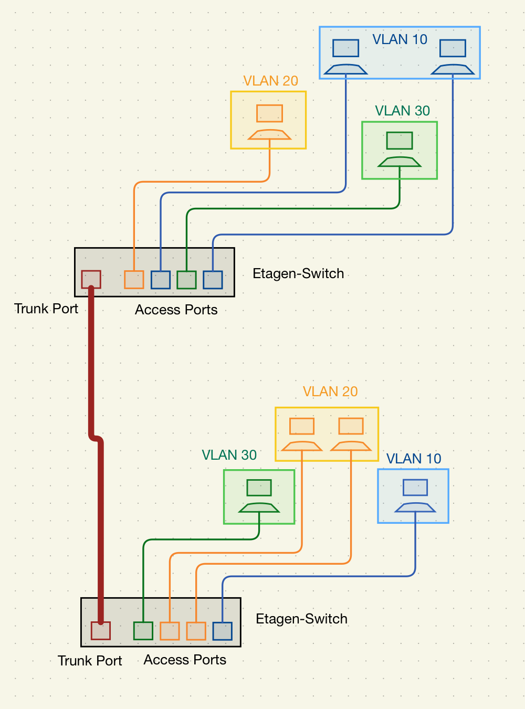
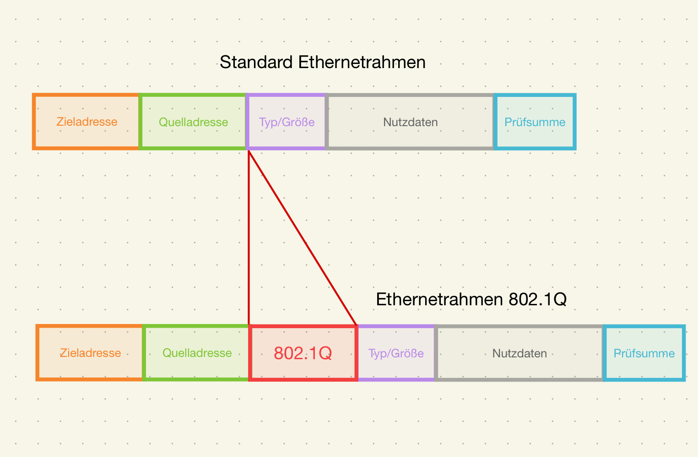
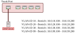
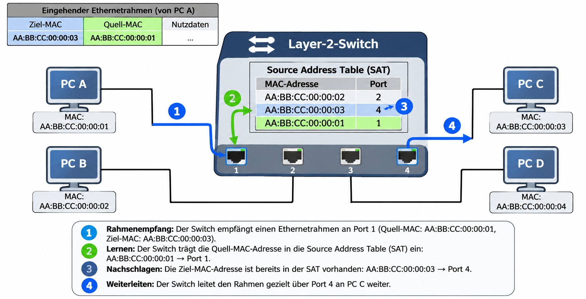
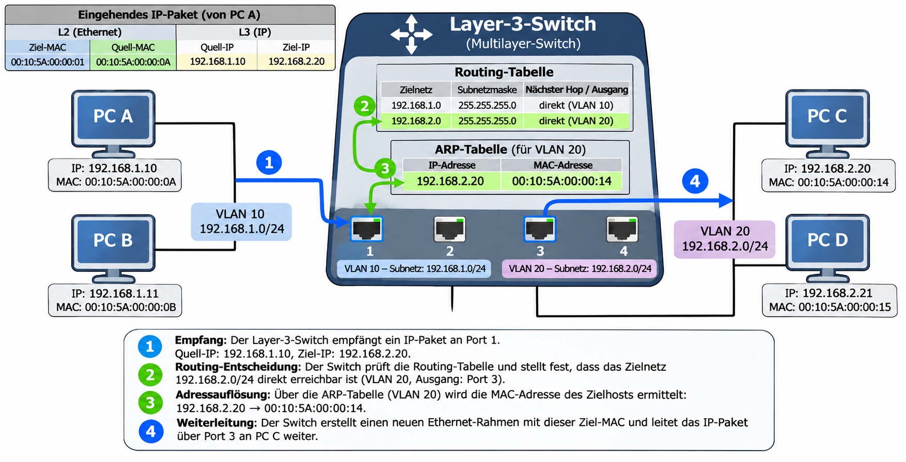
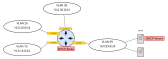
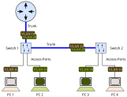

<!--
author:   Günter Dannoritzer
email:    g.dannoritzer@wvs-ffm.de
version:  1.3
date:     11.11.2026
language: de
narrator: Deutsch Female

comment:  VLAN und Layer-3-Switch; Router-on-a-Stick

icon:    https://raw.githubusercontent.com/dsp77/wvs-liascript/0938e2e0ce751e270e3e36b8ecfeb09044a41aa0/wvs-logo.png
logo:     02_img/logo-availability.jpg

tags:     LiaScript, VLAN, 802.1q, Tagging, Trunkport, Layer-3-Switch, Router-on-a-Stick

link:     https://cdn.jsdelivr.net/chartist.js/latest/chartist.min.css

script:   https://cdn.jsdelivr.net/chartist.js/latest/chartist.min.js

attribute: Lizenz: [CC BY-SA](https://creativecommons.org/licenses/by-sa/4.0/)
-->
# Virtual LAN (VLAN)

VLAN steht für Virtual Local Area Network. Es handelt sich dabei um eine Methode, physisch zusammenhängende Netzwerke logisch zu trennen. Mit einer hardwaremäßigen Netzwerkinstallation können logische Einheiten wie Abteilungen einer Firma oder Server- und Client-Netzwerke voneinander getrennt werden. Die so logisch gruppierten Geräte in einem VLAN können miteinander kommunizieren, auch wenn sie an unterschiedlichen physischen Switches angeschlossen sind. Voraussetzung dafür ist eine entsprechende Konfiguration der Switche.

Jedes VLAN bildet eine eigene Broadcast-Domain, wodurch der Broadcast-Verkehr auf das jeweilige VLAN begrenzt wird.

Geräte aus verschiedenen VLANs können nicht direkt miteinander kommunizieren, außer über ein Routing wie zum Beispiel durch einen Layer-3-Switch oder Router.

Ein weiterer Vorteil ist die Flexibilität. Benutzer oder Geräte können unabhängig vom physischen Standort einem bestimmten VLAN zugewiesen werden.

## Grundlegende VLAN-Arten

VLANs werden durch Nummern unterschieden, die sogenannte **VLAN-ID**, und die Zuordnung geschieht auf zwei verschiedenen Arten: **portbasiertes VLAN** und **getaggtes VLAN**.

Beim **portbasierten VLAN** wird im Switch ein bestimmter Port einem VLAN zugeordnet. Nur Ethernetrahmen, die zu dem entsprechenden VLAN gehören, werden über den Port gesendet. Das gilt besonders für Broadcasts oder das Flooding, wenn der Switch das Ziel einer MAC-Adresse nicht kennt. Beim portbasierten VLAN wird der Standard-Ethernetrahmen verwendet. Ein entsprechender Port am Switch wird **Access-Port** genannt.



Das **getaggte VLAN** wird eingesetzt, wenn über einen Port mehrere VLANs übertragen werden müssen. Ein Einsatzszenario ist etwa die Verbindung von Etagenswitchen gemäß der strukturierten Verkabelung. Auf jeder Etage werden die einzelnen Endgeräte gemäß der Zuordnung per portbasiertem VLAN an den Etagenswitch angeschlossen. Hier kann es sein, dass auf einer Etage mehrere Abteilungen untergebracht sind, die alle verschiedenen VLANs zugeordnet sind. Die Etagenswitche werden dann mit dem Gebäudeswitch, in der Regel über eine Glasfaserverbindung, angeschlossen. Hier müssen die verschiedenen VLANs über einen Port übertragen werden. Im Zusammenhang mit VLANs wird so eine Verbindung als **Trunk** bezeichnet und der Port als **Trunk-Port**.



Das Tagging findet mit einem modifizierten Ethernetrahmen statt, der im **IEEE-802.1Q-Standard** beschrieben wird. Der Rahmen wird um das VLAN-ID-Feld erweitert, in dem die VLAN-ID gespeichert wird. Dadurch können über den gleichen Port Rahmen verschiedener VLANs übertragen werden.

Schließlich gibt es noch den **Hybrid-Port** an dem sowohl getaggte, als auch ein ungetaggter Ethernetrahmen gesendet werden kann.


## IP-Vergabe mit VLANs

Mit der Einführung verschiedener VLANs stellt sich die Frage nach der IP-Vergabe in den VLANs. 

Eine Lösung für kleinere oder virtuelle Netzwerke ist, den DHCP-Server per Trunk-Port an den Switch anzuschließen. Der Linux- oder Windows-Server erhält mehrere virtuelle Interfaces und in dem DHCP-Server wird für jedes VLAN ein entsprechender IP-Bereich konfiguriert, der dann über das virtuelle Interface die Anfragen und Vergaben durchführt.



Konfiguration mit Netplan sieht folgendermaßen aus:

`/etc/netplan/01-vlan-config.yaml`

````
network:
  version: 2
  renderer: networkd
  ethernets:
    eth0:
      dhcp4: no

  vlans:
    vlan10:
      id: 10
      link: eth0
      addresses: [10.0.10.1/24]

    vlan20:
      id: 20
      link: eth0
      addresses: [10.0.20.1/24]

    vlan30:
      id: 30
      link: eth0
      addresses: [10.0.30.1/24]

    vlan99:
      id: 99
      link: eth0
      addresses: [10.0.99.1/24]

````

Konfiguration des ISC-DHCP-Servers:

`/etc/dhcp/dhcpd.conf`

````
# DHCP-Server-Konfiguration

default-lease-time 600;
max-lease-time 7200;
authoritative;

# VLAN 10 - Vertrieb
subnet 10.0.10.0 netmask 255.255.255.0 {
  range 10.0.10.100 10.0.10.200;
  option routers 10.0.10.1;
  option domain-name-servers 8.8.8.8;
}

# VLAN 20 - Entwicklung
subnet 10.0.20.0 netmask 255.255.255.0 {
  range 10.0.20.100 10.0.20.200;
  option routers 10.0.20.1;
  option domain-name-servers 8.8.8.8;
}

# VLAN 30 - Produktion
subnet 10.0.30.0 netmask 255.255.255.0 {
  range 10.0.30.100 10.0.30.200;
  option routers 10.0.30.1;
  option domain-name-servers 8.8.8.8;
}

# VLAN 99 - Server
subnet 10.0.99.0 netmask 255.255.255.0 {
  range 10.0.99.50 10.0.99.200;
  option routers 10.0.99.1;
  option domain-name-servers 8.8.8.8;
}
````


# Layer-3-Switch

 * Switch-Funktion mit Switch-Matrix
 * Routing-Funktion mit Routingtabelle
 * Layer-3-Switch mit Routing-Tabelle und Switch-Matrix
 * Logische Sicht auf Netzwerke mit Layer-3-Switch
 * Problem der IP-Vergabe
 * DHCP-Relay für IP-Vergabe - Abgrenzung zur IP-Vergabe wie oben beim VLAN beschrieben


## Layer-2-Switch




> Ein eingehender Ethernet-Frame wird anhand der **Destination-MAC** in der SAT nachgeschlagen und an den passenden Port weitergeleitet.

## Layer-3-Switch



> Ethernetrahmen werden basierend auf der Ziel-IP-Adresse mithilfe der Routingtabelle über den entsprechenden Port weitergeleitet.

## Logische Sicht des Netzwerks mit einem Layer-3-Switch



## IP-Vergabe mit DHCP

Oben wurde die IP-Vergabe durch die Anschaltung eines DHCP-Servers über einen Trunk-Port an den Switch beschrieben. In größeren Netzwerken ist diese Funktion umfangreicher zu konfigurieren und der DHCP-Server wird typischerweise in ein separates VLAN oder Subnetz (z. B. VLAN 99: „Servernetz“) gelegt. Die einzelnen VLANs (z. B. VLAN 10, VLAN 20) bekommen ihre IPs über DHCP-Relay.

Der Layer-3-Switch oder Router übernimmt das Routing zwischen den VLANs und leitet DHCP-Anfragen weiter

Technik: DHCP Relay (IP Helper Address)

 * Der Switch (bzw. das VLAN Interface auf dem L3-Switch) erkennt eine DHCP-Anfrage (Broadcast)
 * Er leitet sie gezielt als Unicast an den DHCP-Server weiter (per ip helper-address)
 * Der DHCP-Server weiß (z. B. durch den VLAN-Tag oder die Relay-Informationen), aus welchem VLAN die Anfrage kam und weist eine passende Adresse aus dem entsprechenden IP-Pool zu


# Router-on-a-Stick

„Router-on-a-Stick“, auch als Single-Arm-Router oder Inter-VLAN-Routing bezeichnet eine Netzwerktopologie, bei der ein einzelner physischer Router-Port genutzt wird, um mehrere VLANs zu routen.



Ein Router hat nur eine physische Schnittstelle. Diese Schnittstelle wird als Trunk-Port konfiguriert und in mehrere Subinterfaces aufgeteilt – etwa:

 * Eth0.10 für VLAN 10

 * Eth0.20 für VLAN 20

Der Switch sendet die VLAN-getaggten Frames über diesen Trunk zum Router. Der Router führt dann das Inter-VLAN-Routing durch und schickt die Pakete wieder über denselben Port zurück.

Als Nachteil dieser Methode, gegenüber der Nutzung eines Layer-3-Switches wird häufig der Flaschenhals der einen Verbindung genannt, da der Verkehr zwischen zwei VLANs zwei Mal über die eine Schnittstelle gesendet wird. Durch Link-Aggregation lässt sich diese Engstelle jedoch vermeiden.

Ein wesentlicher Vorteil gegenüber der Nutzung eines Layer-3-Switches ist, dass der Router mit einer entsprechenden Firewall ausgestattet werden kann und dann ein Zonenkonzept umgesetzt werden kann. Der Verkehr zwischen den VLANs kann dann durch entsprechende Firewall-Regeln geregelt werden. Mithilfe einer Next-Generation-Firewall sind dann auch Intrusion Detection und Prevention möglich. 

# Link Aggregation – Bündelung mehrerer Netzwerkverbindungen

Link Aggregation bezeichnet die Zusammenfassung mehrerer physischer Netzwerkverbindungen zu einer logischen Verbindung. Dadurch können die verfügbare Gesamtbandbreite zwischen zwei Switches erhöht und die Ausfallsicherheit verbessert werden.

## 1. Zwei Verbindungen ohne Link Aggregation

Werden zwei Switches über zwei separate Ethernet-Kabel miteinander verbunden, entsteht eine redundante Verbindung. Ohne geeignete Schutzmechanismen könnten dadurch Netzwerkschleifen entstehen.

lf11-50-switche-mit-schleife.png

Das Spanning Tree Protocol (STP) verhindert solche Schleifen, indem es einen der beiden Übertragungswege blockiert.

● Verbindung 1: Aktiv – Daten werden übertragen.

● Verbindung 2: Blockiert – STP hält diesen Weg als Reserve bereit.

● Nachteil: Trotz zweier Kabel steht nur die Bandbreite einer Verbindung zur Verfügung.

Bei zwei Verbindungen mit jeweils 1 Gbit/s beträgt die nutzbare Gesamtbandbreite zwischen den Switches somit maximal 1 Gbit/s.

## 2. Zwei Verbindungen mit Link Aggregation

Mit Link Aggregation werden die beiden physischen Verbindungen zu einer logischen Verbindung zusammengefasst. Die Switches behandeln die gebündelten Ports als eine gemeinsamme Schnittstelle.

Da STP das Bündel als eine logische Verbindung betrachtet, muss keine der beiden Leitungen wegen einer Netzwerkschleife blockiert werden.

Bei zwei Verbindungen mit jeweils 1 Gbit/s ergibt sich:

● Aggregierte Bandbreite: 2 Gbit/s

● Beide Verbindungen: Aktiv

● Ausfallsicherheit: Fällt ein Kabel aus, kann die Kommunikation über das verbleibende Kabel weiterlaufen.

Die Bündelung kann beispielsweise mit dem Standard IEEE 802.1AX und dem Protokoll LACP (Link Aggregation Control Protocol) realisiert werden.

Wichtige technische Einschränkung

Die doppelte aggregierte Bandbreite bedeutet nicht, dass eine einzelne Datenübertragung automatisch mit 2 Gbit/s erfolgt.

Bei der üblichen Link Aggregation verteilt der Switch unterschiedliche Datenströme auf die verfügbaren Verbindungen. Ein einzelner Datenstrom nutzt normalerweise nur einen physischen Link.

## Vergleich

| Eigenschaft            | Ohne Link Aggregation    | Mit Link Aggregation                     |
|------------------------|--------------------------|------------------------------------------|
| Physische Kabel        | 2 × 1 Gbit/s             | 2 × 1 Gbit/s                             |
| Aktive Verbindungen    | 1                        | 2                                        |
| Aggregierte Bandbreite | 1 Gbit/s                 | 2 Gbit/s                                 |
| Schleifenvermeidung    | STP blockiert einen Pfad | STP betrachtet das Bündel als einen Link |
| Redundanz              | Ja                       | Ja                                       |

## Zusammenfassung

Link Aggregation verbindet mehrere physische Netzwerkleitungen zu einer logischen Verbindung. Dadurch erhöht sich die verfügbare Gesamtbandbreite, ohne dass STP eine der gebündelten Leitungen blockieren muss.